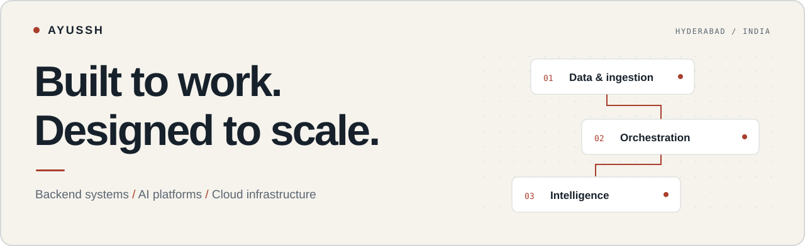

<picture>
  <source media="(max-width: 600px) and (prefers-color-scheme: dark)" srcset="./assets/hero-mobile-dark.svg">
  <source media="(max-width: 600px) and (prefers-color-scheme: light)" srcset="./assets/hero-mobile-light.svg">
  <source media="(prefers-color-scheme: dark)" srcset="./assets/hero-dark.svg">
  <source media="(prefers-color-scheme: light)" srcset="./assets/hero-light.svg">
  
</picture>

  <strong>Lead Founding Engineer &amp; Forward Deployed Engineer at Quper</strong> 
  Hyderabad, India · From architecture to production, with the customer in the loop.

  <a href="mailto:ayush.krsh9@gmail.com">Email</a> &nbsp; / &nbsp;
  <a href="https://www.linkedin.com/in/ayusshkumr/">LinkedIn</a> &nbsp; / &nbsp;
  <a href="https://github.com/TheArchitect19?tab=repositories">Repositories</a> &nbsp; / &nbsp;
  <a href="#selected-work">Selected work</a>

 

I build **AI and data platforms that run in production**. At **Quper**, I lead a nine-person engineering team and work directly with customers—from requirements and architecture to SaaS and bring-your-own-cloud deployments.

My work spans cloud cost intelligence, voice AI, workflow orchestration, and distributed data systems. I also build models from scratch to understand the machinery beneath the API.

<table>
  <tr>
    <td align="center" width="25%"><h3>9</h3>Engineers led at Quper</td>
    <td align="center" width="25%"><h3>1B+</h3>Rows ingested into PostgreSQL</td>
    <td align="center" width="25%"><h3>139+</h3>Integrations across 24 providers</td>
    <td align="center" width="25%"><h3>300M</h3>Parameters trained from scratch</td>
  </tr>
</table>

 

## Selected work

<table>
  <tr>
    <td valign="top" width="50%">
      01 / CLOUD INTELLIGENCE
      <h3>Quper</h3>
      
A multi-cloud FinOps platform taken from architecture to a commercially sold product, with production deployments at <strong>The Chatterjee Group and ABP</strong>.

      
Built three product lines: <strong>FinOps</strong>, <strong>DataFinOps</strong>, and <strong>Vidura</strong>. Cost and usage pipelines span AWS, GCP, Azure, Databricks, and Redshift, with SaaS and BYOC delivery.

      
<code>Temporal</code> <code>ECS Fargate</code> <code>Kubernetes</code>

    </td>
    <td valign="top" width="50%">
      02 / REAL-TIME AI
      <h3>Voice agent infrastructure</h3>
      
A production voice AI platform connecting <strong>real PSTN calls</strong> to tenant-specific agents through Exotel SIP trunks and LiveKit.

      
Separated call transport, state, and billing from LLM reasoning. Added idempotent call finalization, webhook reconciliation, outbound workflows, and human escalation.

      
<code>LiveKit</code> <code>SIP</code> <code>Redis</code> <code>Temporal</code>

    </td>
  </tr>
  <tr>
    <td valign="top" width="50%">
      03 / DISTRIBUTED DATA
      <h3>Data infrastructure at scale</h3>
      
A fault-tolerant ETL pipeline ingesting <strong>over a billion rows</strong>, with hash-based PostgreSQL sharding for writes and ClickHouse for analytical reads.

      
Aggregated fan-out queries at the application layer and improved serialization performance by <strong>60%</strong> using Protocol Buffers.

      
<code>PostgreSQL</code> <code>ClickHouse</code> <code>Protobuf</code>

    </td>
    <td valign="top" width="50%">
      04 / MODEL ENGINEERING
      <h3>A language model, from first principles</h3>
      
A <strong>300M-parameter decoder-only transformer</strong> for LinkedIn post generation, designed and trained from scratch on Apple Silicon.

      
Custom BPE tokenizer, RoPE, causal attention, KV cache, SwiGLU, and pre-RMSNorm. Built the training loop with bfloat16, gradient clipping, and cosine scheduling.

      
<code>PyTorch</code> <code>Metal / MPS</code> <code>Transformers</code>

    </td>
  </tr>
</table>

 

## Experience

**Quper** · Lead Founding Engineer / Forward Deployed Engineer  
Jun 2026 — Present  
Leading engineering, product delivery, and customer deployments for a multi-cloud FinOps platform.

**Steps AI** · AI Engineer / Platform Engineer  
Oct 2025 — Jun 2026  
Built voice agents, human-in-the-loop systems, and a DAG workflow engine using Kahn’s topological sort, per-step error policies, and a dead-letter queue.

**Cricut** · Software Engineer, contract via Xequalto Analytics  
Nov 2025 — Apr 2026 · Remote, US team  
Built Redshift monitoring and an AI performance advisor; deployed services on Kubernetes and ECS Fargate.

**Xequalto Analytics** · Software Development Engineer  
Aug 2024 — Oct 2025  
Built large-scale data pipelines, GraphQL services, and zero-downtime deployments with ArgoCD, OIDC, and ECR.

 

## Tools I work with

| Area | Technologies |
| :--- | :--- |
| **Languages** | Python · TypeScript · JavaScript · Go · C++ · SQL |
| **Backend & workflows** | FastAPI · NestJS · Node.js · Django · Temporal · GraphQL · Protobuf |
| **Data systems** | PostgreSQL · Redshift · ClickHouse · Redis · Airflow · AWS Glue |
| **Cloud & delivery** | AWS · GCP · Azure · Kubernetes · Docker · ArgoCD · CI/CD · OIDC |
| **AI & voice** | PyTorch · Transformers · BPE · LiveKit · SIP · Exotel · WebSocket · SSE |

 

## Beyond the day job

**ICPC Regionalist ’23 · National Rank 73** &nbsp; / &nbsp; **LeetCode · Top 7% globally**

- **[Keploy](https://github.com/keploy/keploy)** — Refactored services to NestJS and built repository analytics.
- **[CloudCV / EvalAI](https://github.com/Cloud-CV/EvalAI)** — Added 100+ tests, upgraded PostgreSQL, and improved API documentation.
- **AskSenior** — Scaled the backend to support 10,000+ users.

B.E. in Computer Science · Chandigarh University · 2021–2025

 

---

  <strong>Working on a difficult systems problem?</strong> 
  <a href="mailto:ayush.krsh9@gmail.com">Let’s talk.</a> &nbsp; ayush.krsh9@gmail.com

